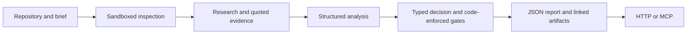

# Condere

**The open-source spin-off analyst for your code.**

Point Condere at a software repository to explore whether it could become a business,
who would pay, and what to build next. It inspects the code, gathers outside evidence,
compares commercialization routes, and returns a **pursue-or-stop decision** with linked
reasoning and a build plan your coding agent can read.

[Get started](docs/self-hosting.md) · [Use with Claude Code or Codex](docs/mcp.md) ·
[Architecture](docs/architecture.md) · [Report format](docs/report.md)

> **Developer preview.** The current local storage implementation uses MinIO.
> Garage is the intended long-term self-hosted replacement; migration and clean-install
> verification are still in progress. See [current limitations](docs/status.md).

## From repository to business decision

Condere is for maintainers, technical founders, and teams evaluating software they
might spin into a product. It considers routes such as open core, managed hosting,
dual licensing, services, and AI-native offerings.

- **Understand the asset.** Inspect admitted repository snapshots in an isolated sandbox
  and connect the proposed business to actual code.
- **Investigate the buyer.** Gather outside evidence, distinguish observations from
  hypotheses, and preserve unanswered questions.
- **Compare the options.** Explain what stays open, what customers pay for, who buys,
  and the case for and against each route.
- **Make a structured call.** A decision model answers typed questions; code applies
  gates and records any adjustments to its answers.
- **Hand off the findings.** Retrieve the compact result, follow links to supporting
  evidence, or export the saved assessment without rerunning research.

Quoted claims are checked against saved sources. That establishes quotation fidelity,
not proof that a market exists. A recommendation does not authorize implementation,
deployment, publication, outreach, or further spending.

## What you get

The `condere.spinoff.v1` report includes:

| Part | What it tells you |
|---|---|
| Decision | Pursue or stop, the selected option and route, probabilities, gates and adjustments |
| Reasoning | The thesis and the case for and against the options |
| Analysis | What the software does, rights and ownership questions, and buyer evidence |
| Next test | The assumption to test, method, success/failure conditions, and estimated effort |
| Build plan | Proposed capabilities and work packages tied to the software, when applicable |
| Evidence | Links to claims, sources and detailed artifacts, with hashes and summaries |

Start with the compact report and fetch only the detail you need. See the
[report reference](docs/report.md) for the contract and retrieval workflow.

## Get started

You need Python 3.12 or 3.13, [uv](https://docs.astral.sh/uv/), PostgreSQL,
an S3-compatible evidence store, and a supported sandbox backend. Research also
requires OpenRouter and Exa credentials. Self-hosting storage avoids cloud storage
charges; external model and research services can still incur costs.

From the repository root:

```sh
uv sync --locked --group dev
cp .env.example .env
```

Follow the [self-hosting guide](docs/self-hosting.md) to configure storage, prepare
the sandbox, generate the API identity, and register an explicit research allowance.
Once those prerequisites are complete, start the API:

```sh
uv run --env-file .env python scripts/run_local.py api
```

The local API uses bearer authentication at `http://127.0.0.1:7778`.
Connect [Claude Code or Codex over MCP](docs/mcp.md), then use an authorized campaign
to admit an assessment. `read_report` retrieves its saved result; `read_artifact`
opens supporting detail and `export_assessment` saves a portable bundle.

Configuration comes from environment variables. Doppler is optional, and LangSmith
tracing is disabled when its API key is absent. See the
[configuration reference](docs/configuration.md).

## Local development and cloud deployment

| Component | Local development | Cloud deployment |
|---|---|---|
| State and checkpoints | Self-hosted PostgreSQL, with separate databases and roles | PostgreSQL; the hosted deployment uses Neon |
| Evidence objects | MinIO today; Garage is the long-term self-hosted target | S3-compatible storage; the hosted deployment uses Cloudflare R2 |
| Code inspection | SmolVM; prior verification on macOS Apple silicon | Modal adapter |
| Tracing | Optional LangSmith | Optional LangSmith |

Garage is a planned replacement, not an available Compose setup in this checkout.
The runtime uses an S3 interface so storage bindings can differ between environments;
each backend still needs to pass the evidence-storage checks. **macOS on Apple
silicon is the tested local platform. Windows and Linux are untested.**

## How it works



Condere runs on Deep Agents and LangGraph. PostgreSQL holds state, spending records
and checkpoints; object storage retains source evidence. Sandboxes inspect code
without network access or provider credentials. Model calls and evidence retrieval
are handled by the trusted runtime. See [architecture](docs/architecture.md).

The runtime supports OpenAI plan sign-in or OpenRouter for analysis, TypeSafe Jev
through OpenRouter for decisions, and Exa for search. Apify enables optional research
sources. Self-hosted storage does not make external model processing local; review
[data boundaries](SECURITY.md#data-boundaries) before submitting private material.

## Open core

The runtime, agent prompts, skills and self-hosting adapters in this repository are
[MIT licensed](LICENSE). Commercial features are licensed separately and are not
included here. Private production configuration, evaluation datasets and improvement
routines are maintained outside the public core. See [licensing](docs/licensing.md).

## Contributing

Read [CONTRIBUTING.md](CONTRIBUTING.md) for development and verification guidance.
Provider-free checks run without service credentials:

```sh
uv run ruff check src scripts tests
uv run pytest tests -q
```

Integration tests are opt-in. Report vulnerabilities privately as described in
[SECURITY.md](SECURITY.md).
